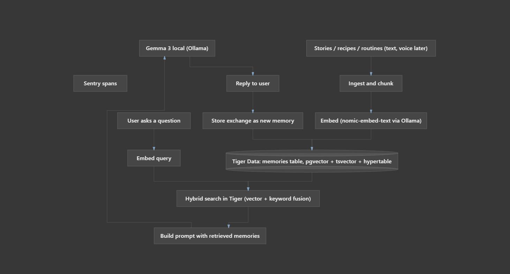

# Keepsake

A private, offline AI companion that becomes the long-term memory of one grandparent.

Built for a real person. Their stories, recipes, routines, and people live on your laptop — not on someone else's server. Local **Gemma 3** (via Ollama) does the talking. **Tiger Data** (Postgres + pgvector + full-text + Timescale) does the remembering.

## Why this exists

Closed chatbots forget. Cloud notebooks feel wrong when the subject is family history. Keepsake keeps the archive at home: hybrid search over growing episodic memory, so every conversation makes the next one more personal.

## Architecture



Stories go in → embeddings land in Tiger Data → hybrid search (vector + keyword) builds the prompt → Gemma 3 answers locally → the exchange is stored so memory grows. Sentry wraps embed, retrieve, and generate.

## Quickstart

```bash
# 1. Ollama with models already pulled
ollama pull gemma3:4b
ollama pull nomic-embed-text

# 2. Configure secrets (never commit .env)
cp .env.example .env
# set DATABASE_URL (Tiger Cloud) and optional SENTRY_DSN

# 3. Install
python -m venv .venv
# Windows: .venv\Scripts\activate
pip install -r requirements.txt
pip install -e .

# 4. Init schema + seed demo memories
python -m keepsake init
python -m keepsake seed

# 5. Ask something real
python -m keepsake chat "What dal does Dadi make on Sundays?"
python -m keepsake onthisday
```

## How it works

1. **Ingest** stories / recipes / people notes as markdown (optional YAML header for kind, people, tags).
2. **Embed** locally with `nomic-embed-text`.
3. **Store** in Tiger Data: `vector` + `tsvector` + Timescale hypertable on `created_at`.
4. **Retrieve** with reciprocal-rank fusion of cosine similarity and full-text rank.
5. **Answer** with Gemma 3 grounded only in retrieved memories.
6. **Grow** — each chat turn is written back into memory.

Optional: point Cursor at `.cursor/mcp.json` so Tiger MCP can query the same database the agent uses.

## Stack

| Layer | Choice |
|---|---|
| Chat | Gemma 3 (`gemma3:4b`) via Ollama |
| Embeddings | `nomic-embed-text` via Ollama |
| Memory | Tiger Data — pgvector, GIN full-text, Timescale hypertable |
| Observability | Sentry transactions/spans around embed → retrieve → generate |
| UI | Typer + Rich CLI |

## Commands

```text
python -m keepsake init
python -m keepsake seed
python -m keepsake ingest path/to/memory.md
python -m keepsake chat "Who is Uncle Ravi?"
python -m keepsake onthisday
python -m keepsake status
```

## Privacy

No cloud LLM calls. Chat and embeddings hit localhost Ollama. The only remote piece is your Tiger database (or a local Postgres with pgvector if you swap the URL). Put real family text in `.env`-gated deployments you control.

## License

MIT
